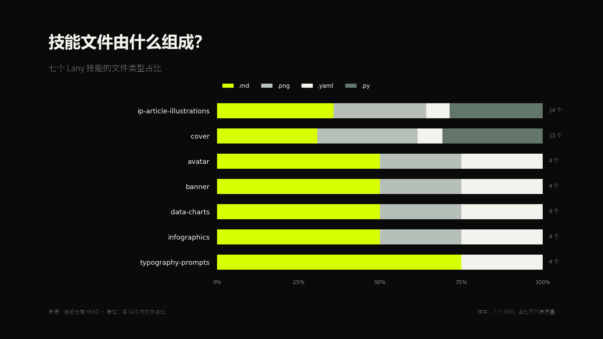
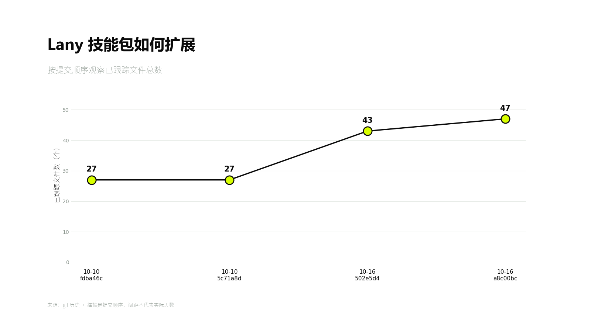
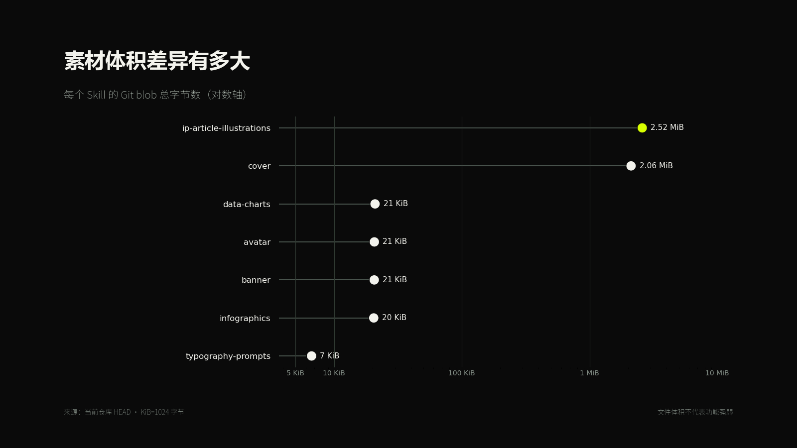
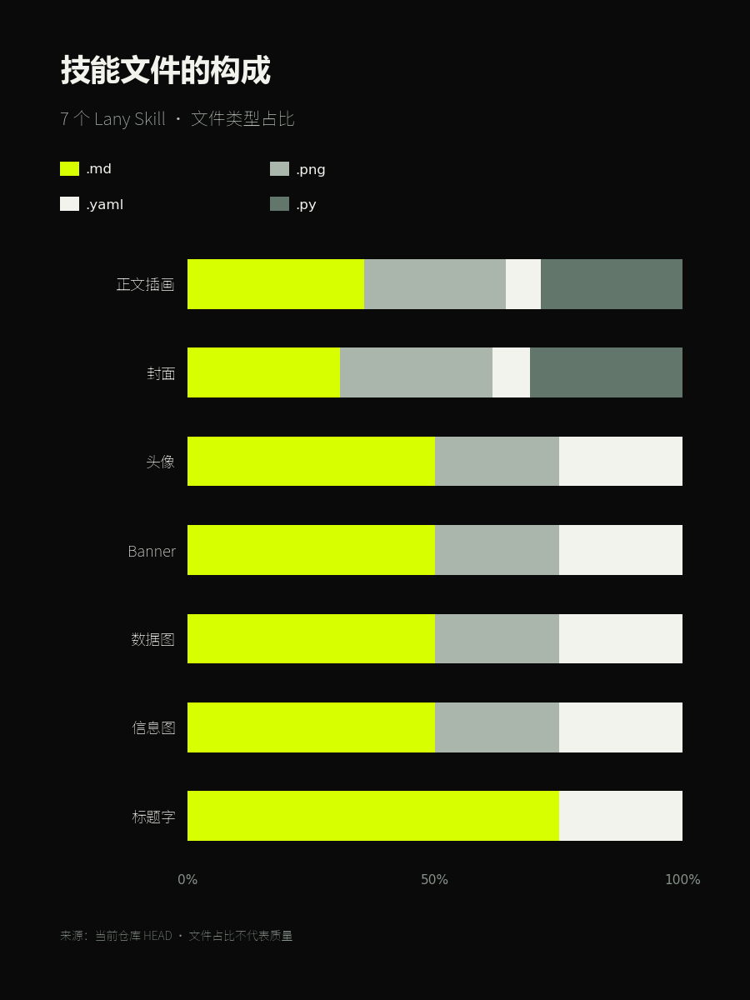

# Lany Data Charts

`$lany-data-charts` 用 Lany 小生的视觉体系制作文章数据配图、趋势图、比较图、动态数据画面和数据简报。它先确认数据、单位、口径和来源，再选择图型；没有真实数据时只能生成明确标为“示意”的样稿。

默认交付包括数据或数据引用、可复核计算、可编辑 SVG/HTML/代码和最终 PNG。黑 / 白 / `#D8FF00` 用于建立品牌识别，数据可读性优先于装饰。

## 快速使用

```text
使用 $lany-data-charts 读取下面的数据文件并制作一张适合 X 长文的 16:9 数据图。

数据：<CSV / XLSX / Markdown 表格路径>
要回答的问题：<一句话>
单位：<单位>
时间范围：<起止时间>
来源：<来源与日期>

请先检查缺失值、分母和不可比较项，再选择合适图型。保存原始输入、计算结果、可编辑源文件和 PNG；在图内或图旁标明来源。
```

```text
使用 $lany-data-charts 分析这份报告里的真实数据，先提出 1—3 个可验证结论，再分别选择最合适的图型。不要预设一定使用柱状图，也不要为了视觉效果截断或改变数据关系。

报告：<文件路径或正文>
```

## 示例 1：构成比例

适合多个对象拥有同一组分类，并且每个对象需要比较内部构成。

```text
使用 $lany-data-charts 统计当前仓库中七个 Lany Skill 的已跟踪文件类型占比。

数据来源：git ls-tree -r HEAD。
分类：.md、.png、.yaml、.py；没有实际出现的分类不显示。
图型：100% 横向堆叠条形图。
要求：每个 Skill 标出文件总数；单位为“文件占比”；注明“占比不代表质量”；输出 16:9 PNG、SVG 和汇总 CSV。
```



## 示例 2：提交历史

适合少量时间点或离散阶段的变化。

```text
使用 $lany-data-charts 读取 lany-skills 的 Git 历史，统计每次提交后 lany-* 目录中的已跟踪文件总数。

图型：带节点数值的折线图。
横轴：提交日期 + 短 SHA；相同日期保留为不同提交点。
纵轴：已跟踪文件数，单位“个”。
注明：横轴按提交顺序等距排列，间距不代表实际天数。
输出数据 CSV、16:9 PNG 和 SVG。
```



## 示例 3：跨数量级比较

当最大值和最小值相差数百倍时，线性轴会压扁小值；可以使用明确标注的对数轴。

```text
使用 $lany-data-charts 统计七个 Lany Skill 的 Git blob 总字节数。

图型：横向点图；横轴使用对数刻度。
标注：KiB=1024 字节；1 MiB=1024 KiB；每个点直接显示 KiB 或 MiB。
来源：当前仓库 HEAD。
必须在图上注明“文件体积不代表技能强弱”。输出 PNG、SVG 和源数据。
```



## 示例 4：手机竖版重排

同一份比例数据在横版缩图里会出现长标签和图例过小的问题。竖版要缩短名称并增加每行高度。

```text
使用 $lany-data-charts 把“七个 Lany Skill 文件类型占比”重排为 3:4 手机竖版。

把技能名缩短为：正文插画、封面、头像、Banner、数据图、信息图、标题字。
图例只保留实际存在的 .md、.png、.yaml、.py。
横轴只显示 0%、50%、100%，每行保留足够高度；输出 400px 预览并检查分类名称与主比例是否可读。
```



## 已观察到的边界

- 七组 100% 堆叠条形图在完整 16:9 中可读，但缩到 400px 后图例与长技能名过小。
- 四个节点的趋势图在手机缩图中仍能表达主趋势；节点多、日期密集时需要减少标签或拆图。
- 对数轴能展示跨数量级数据，但必须明确标注，且不适合希望读者直接比较绝对差值的场景。
- 竖版与短中文标签能提高信息流可读性；精确比例仍需要点开或直接标值。
- 图表不能从不完整数据推断结论；分母、单位、缺失值、时间范围或来源不清时，应先补数据。
- 文件数量与体积示例用于测试图型，不代表 Skill 质量评分。

完整规则见 [SKILL.md](SKILL.md) 与 [data-rules.md](references/data-rules.md)。
