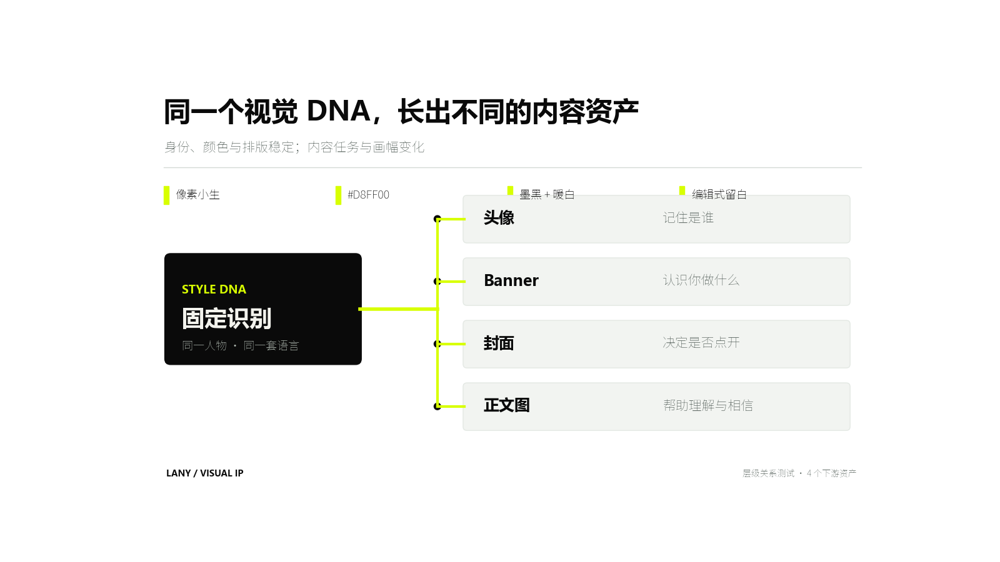
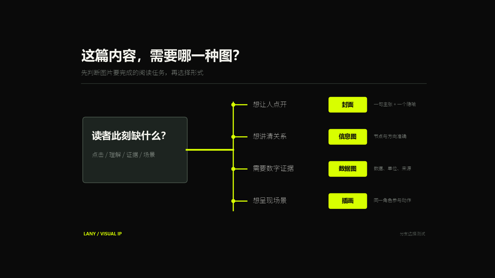
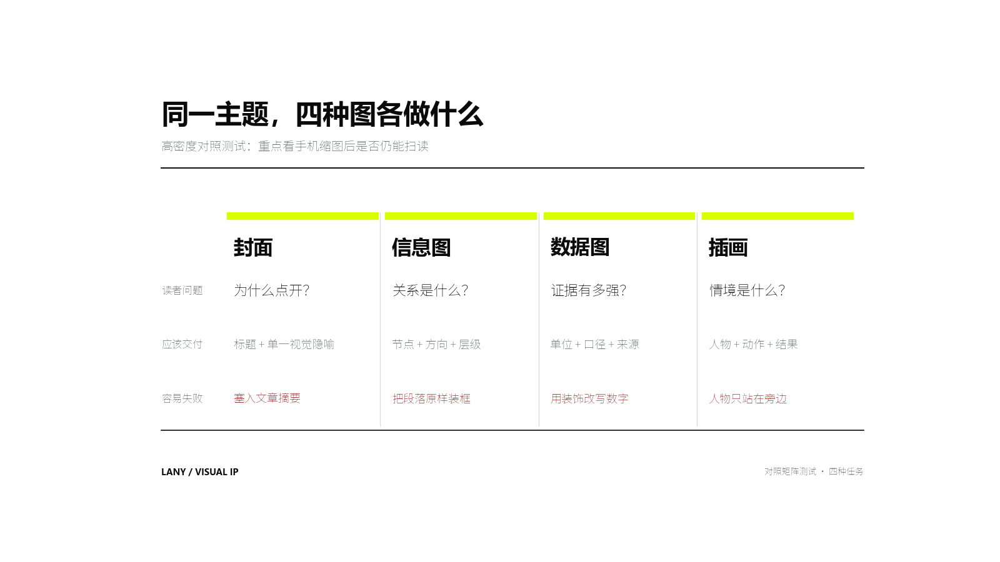
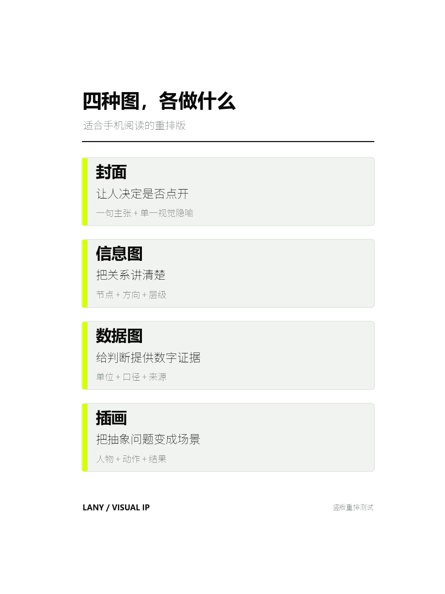

# Lany Infographics

`$lany-infographics` 把文章、工具教程和复杂概念整理成品牌一致的流程图、关系图、层级图、对比图和时间线。它负责解释结构；主要由数字构成的内容交给 `$lany-data-charts`。

默认视觉使用 Lany 小生的黑 / 白 / 荧光黄绿 `#D8FF00` 系统。重要文字与节点优先用可编辑的 SVG、HTML/CSS 或绘图代码制作，以保证中文和关系准确；人物只在确实参与核心动作时出现。

## 快速使用

```text
使用 $lany-infographics，把下面的内容整理成一张适合 X 长文的 16:9 信息图。

读者看完需要理解：<一句话>
内容：<文章、段落、流程或关系>
输出：PNG + 可编辑 SVG；使用 Lany 黑白荧光绿视觉。
```

```text
使用 $lany-infographics 先分析这篇文章，决定最需要解释的 1—3 个关系，生成信息图计划并逐张出图。每张图只解释一个关系，并报告建议插入的正文段落。不要把图片堆到文末。

文章：<文件路径或正文>
```

## 示例 1：层级关系

适合回答“一个共同来源如何影响多个下游”。

```text
使用 $lany-infographics 制作一张 16:9 层级关系图。

核心结论：同一个视觉 DNA，可以长出头像、Banner、封面和正文图。
上游规则：像素小生、#D8FF00、墨黑与暖白、编辑式留白。
下游资产：
1. 头像——记住是谁
2. Banner——认识你做什么
3. 封面——决定是否点开
4. 正文图——帮助理解与相信

要求：关系方向唯一，文字准确，PNG 与可编辑 SVG 同时保存。
```



## 示例 2：选择分支

适合把一个决策拆成有限分支。

```text
使用 $lany-infographics 制作一张 16:9 选择分支图，标题为“这篇内容，需要哪一种图？”。

起点：读者此刻缺什么？
- 想让人点开 → 封面 → 一句主张 + 一个视觉隐喻
- 想讲清关系 → 信息图 → 节点 + 方向 + 层级
- 需要数字证据 → 数据图 → 数据 + 单位 + 来源
- 想呈现场景 → 插画 → 人物 + 动作 + 结果

使用深色 Lany 视觉，让四个结果标签在手机缩图里优先可读。
```



## 示例 3：高密度横向对照

适合桌面阅读或文章内可点开放大的对照内容。

```text
使用 $lany-infographics 制作一张 16:9 四列对照矩阵。

列：封面 / 信息图 / 数据图 / 插画。
行：读者问题 / 应该交付 / 容易失败。
内容：
- 封面：为什么点开？/ 标题 + 单一视觉隐喻 / 塞入文章摘要
- 信息图：关系是什么？/ 节点 + 方向 + 层级 / 把段落原样装框
- 数据图：证据有多强？/ 单位 + 口径 + 来源 / 用装饰改写数字
- 插画：情境是什么？/ 人物 + 动作 + 结果 / 人物只站在旁边

输出 PNG 与可编辑 SVG，并额外导出 400px 宽预览检查手机可读性。
```



## 示例 4：竖版重排

横向四列在手机信息流里会变得太小。竖版需要重新组织层级，不能直接裁切横图。

```text
使用 $lany-infographics 把上面的四列对照改成 3:4 竖版。

每一类做成一张纵向卡片，只保留：类别、读者需要、应交付内容。删除“容易失败”一行，保证 400px 宽仍能读清四个分类和主要说明。输出 PNG 与 SVG。
```



## 已观察到的边界

- 16:9 下四个主节点、四个分支和四列大标题表现稳定。
- 横向四列同时放三层文字时，缩到 400px 宽只能认出大标题；细节需要点开。
- 竖版逐项排布更适合手机，但第三层浅色注释仍不应过长。
- 超过约 5 个节点、出现交叉连线，或每个节点需要一整段解释时，应拆成多张图或改成交互页面。
- 信息图可以展示关系与流程，不能代替数据图的单位、口径和来源。

完整规则见 [SKILL.md](SKILL.md) 与 [diagram-rules.md](references/diagram-rules.md)。
